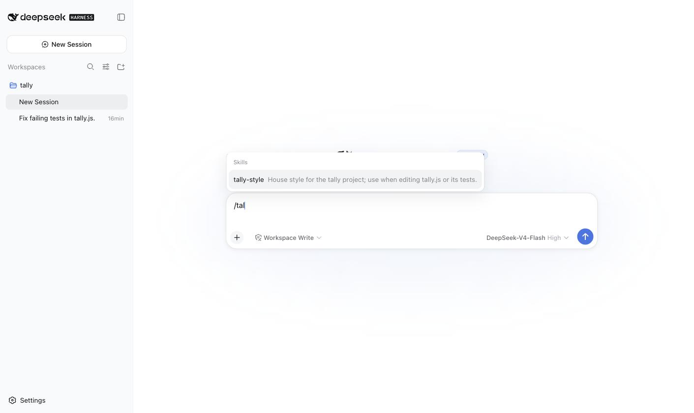

# Coming from Claude Code (or Codex)

English | [中文](coming-from-claude-code.zh.md)

Verified against `@deepseek-ai/dsh` **0.1.0-rc.6** (harness tree `47f9438`) on 2026-08-15. Every dsh claim in the table names the source that backs it; Claude Code facts are external and stated as of the same date. Both tools move fast.

For: someone who runs Claude Code or Codex daily and wants to know, in ten minutes, what carries over unchanged, what has a different name, and what does not exist. Not a comparison of model quality; that needs a benchmark, not a table.

The short version: your project `CLAUDE.md` and your `SKILL.md` skills work untouched. Your MCP servers and your `hooks.json` need one YAML row each. Your *global* `CLAUDE.md` needs a copy to a new name — that is the one thing people assume works and it does not. What you lose is the terminal: dsh is a browser app plus a one-shot CLI, and the "TUI" you may have seen is community work.

## The map

| You know | In dsh | Backed by |
|---|---|---|
| `claude` (TUI in your terminal) | `npx @deepseek-ai/dsh web`, a browser app on `127.0.0.1:3080`. No in-tree TUI; the shipped one was deleted 2026-08-04 (`.agents/notes/implemented/simplification/2026-08-04-remove-tui-package.md`). Community TUIs exist (search the `dsh-plugin` topic); upstream itself points at `github:deepseek-harness/turtle-ui`. | `apps/cli/reference/README.md` |
| `claude -p "task"` (headless) | `dsh --profile headless "task"`: prints only the final text, exit 0 on completion. Reads your project instruction files like the web app does. `--output-format json` has no equivalent; the JSON demo CLI was deleted 2026-08-08. Machine consumers use the Python SDK or JSON-RPC. | `apps/cli/reference/README.md`, `.agents/notes/implemented/simplification/2026-08-08-remove-cli-demo.md` |
| `~/.claude/CLAUDE.md`, `./CLAUDE.md`, `CLAUDE.local.md` | **Project files carry over untouched; the global one does not.** The user-global file is always `$DSH_HOME/AGENTS.md` — `~/.claude/CLAUDE.md` is never read, so copy it there yourself, and note the global scope takes no `.local.md` overlay. Below that, in every directory from the project root (nearest `.git`) down to the cwd: `AGENTS.md` and `CLAUDE.md`, plus `AGENTS.local.md` / `CLAUDE.local.md` overlays. Siblings that are byte-identical after trimming collapse to one, per directory. 64 KiB render budget. Two things silently do not carry: `@path` imports and `.claude/rules/` are not interpreted. | `packages/context/agent-instructions/README.md` |
| `~/.claude/skills/<name>/SKILL.md`, `.claude/skills/` | Same file format. Roots in match order, first one wins: `<project>/.dsh/skills`, `<project>/.agents/skills`, configured extra dirs, `$DSH_HOME/skills`, `~/.agents/skills`. Skills you installed into `~/.agents/skills` with `npx skills add` are therefore already visible to dsh, with a project-level skill of the same name shadowing them. Names must be kebab-case; frontmatter needs `name` + `description`; nested `SKILL.md` is not discovered. Roots are live-watched. | `packages/skill/skill-filesystem/README.md` |
| `/skill-name` | Same: `/<name>` in the composer, listed under "Skills" in the `/` menu. `user-invocable: false` keeps it out of that menu; `disable-model-invocation: true` keeps it away from the model. | `packages/skill/skill-filesystem/README.md`, `packages/client/ui-skill/README.md` |
| `.claude/commands/*.md` (custom slash commands) | No separate concept. A skill with `user-invocable` on is your slash command. Built-in commands today: `/compact`, `/export`, `/feedback`, `/goal`, `/permission`, `/plan`, `/model`. | `packages/interaction/commands/README.md`; the `/` menu |
| `hooks.json` / settings `hooks` | Opt-in bridge plugin `@deepseek-ai/dsh-hooks-claude-code`: runs your existing `hooks.json` for `SessionStart`, `UserPromptSubmit`, `PreToolUse`, `PostToolUse`, `Stop`, `SubagentStart`, `SubagentStop`. Only `type: "command"` hooks run; `http`/`mcp_tool`/`prompt`/`agent` hooks are parsed and skipped with a warning. One config per process, not per session. `updatedInput` rewrites are logged, not honored. `${CLAUDE_PROJECT_DIR}` works. Codex has its own bridge. | `packages/hooks/hooks-claude-code/README.md` |
| `.mcp.json`, `claude mcp add` | One `@deepseek-ai/dsh-mcp-client` row per server in a patch layer; `stdio` or `streamable-http`; tools appear as `mcp__<server>__<name>`, same shape as Claude Code. Shipped as a dependency, none enabled by default. No OAuth flow yet. | `packages/mcp/mcp-client/README.md`, `apps/cli/reference/README.md` |
| Permission modes (`default`, `acceptEdits`, `plan`, `bypassPermissions`) | Permission presets: `workspace-write` (sandbox confines writes to the workspace + temp; approval only when the model asks to escalate) is the default; `danger-full-access` (no sandbox, never ask). The composer pill also offers Read Only. Plan mode is `/plan` + `exit_plan_mode`, and it is soft guidance — a separate thing from the sandbox and from approval. | `docs/subsystems/permission-presets.md`, `docs/subsystems/sandbox.md`, `packages/plan/plan-mode/README.md` |
| Sandbox (macOS seatbelt for bash, opt-in) | Sandbox is on by default: Linux bwrap/Landlock, macOS Seatbelt, Windows ACL (partial enforcement there, and on older Landlock kernels). It governs filesystem effects only; network and process visibility are out of scope. If no backend works on your machine, commands do not silently run unconfined; they fail with `SANDBOX_UNAVAILABLE`. | `docs/subsystems/sandbox.md`, `packages/sandbox/sandbox-local/README.md` |
| `.claude/agents/*.md` (subagents) | Two things. Delegation: `subagent` / `subagent_fork` tools with providers `spawn`, `fork` (in-process); `codex` and `claude-code` providers exist but are not in the base bundle. Persona-with-tools: an **agent preset** (a directory with `agent.cordis.yml`). Four ship: `standard`, `code`, `minimal`, `cordis` — the UI labels them Standard / Code / Minimal / **Creator** mode, so the id and the label differ on the last one. Copies live in `$DSH_HOME/.agent-presets/`. "Agent teams" is not a dsh term. | `docs/subsystems/subagent.md`, `packages/preset/agent-presets/README.md` |
| `~/.claude/settings.json` | `$DSH_HOME/settings.yaml` for user settings; `$DSH_HOME/profiles/<name>/cordis.patch.yml` and `$DSH_HOME/cordis.patch.yml` for composition (which plugins, with which config). Two files, two jobs. | `apps/cli/reference/README.md` |
| `ANTHROPIC_API_KEY`, OAuth login, subscription | For the native DeepSeek provider: `DEEPSEEK_API_KEY` or Settings > Models. API key only, no OAuth and no subscription tier; you pay DeepSeek's per-token API prices. Precedence: env > `$DSH_HOME/.credentials.yaml` > `./.env` > `$DSH_HOME/.env`. | `packages/credentials/credentials-local/README.md`, `packages/llm/llm-deepseek/README.md` |
| Model choice, `ultrathink` | `/model` or the composer's model control, which also exposes whatever reasoning-effort levels that model's adapter advertises; the DeepSeek adapter defaults to High. Anthropic, OpenAI, Bedrock, Vertex, Azure, and Codex are in the provider catalog, so you can run Claude models inside dsh. | `docs/user/guide/providers.md`, `packages/client/ui-model-selection/README.md`, `packages/llm/llm-deepseek/README.md` |
| `--resume`, `--continue`, `~/.claude/projects/*.jsonl` | Sidebar, per workspace; click the session. Neither the web app nor headless takes a `--resume` flag today (the launcher help's `--profile tui --resume` example names a profile that no longer ships). Logs: `$DSH_HOME/sessions/--<normalized cwd>--/<encoded session id>/session.jsonl.zstd` — JSONL stored as concatenated zstd frames; `/export` downloads a ZIP. | `dsh --profile web --help`, `packages/session/session-persistence-jsonl/README.md`, `packages/session-query/session-log-export/README.md` |
| `/cost`, ccusage | Status line under the composer: turns, steps, LLM time, TTFT, tok/s, cache hit %, input/output tokens. When the adapter reports usage, each step carries it on its `assistant/message` event. | observed, plus `packages/session/session-stats/README.md`, `packages/llm/token-meter/README.md` |
| Plugins, marketplaces | `dsh plugin --profile web add <npm-package | github:owner/repo>`; the package must declare `dsh.bundle` in `package.json` or it installs as a plain dependency and does nothing. No marketplace; discovery is the `dsh-plugin` GitHub topic and community registries (ours: `dshworks/awesome-dsh-plugins`). A git package with a `prepare` script runs code at install time once you allowlist its build, and that code runs outside the sandbox. | `docs/user/develop/basic/publish.md` |
| WebSearch / WebFetch | `web_search` is on (DeepSeek's search provider, needs your DeepSeek key); `web_fetch` is off until a patch enables a provider. | `apps/cli/reference/README.md` |
| VS Code / JetBrains extension | None in-tree. Discussion #172 asked for a standalone client, a CLI, and a VS Code plugin; 159 upvotes as of 2026-08-15, and the most-upvoted request on day one. It does not mention JetBrains. | GitHub Discussion #172 (external) |
| `CLAUDE_PROJECT_DIR` | Exported to bridged hooks. The harness's own variables are `DSH_HOME`, `DSH_AGENTS_HOME`, `DSH_PERMISSION_MODE`, `DSH_TOOLS_MODE`, plus `DSH_WEB_URL` under the web profile only. | `packages/hooks/hooks-claude-code/README.md`, `packages/skill/skill-filesystem/README.md`, `packages/bundle/web-app/README.md`, `apps/cli/reference/README.md` |

## Five things to do in the first ten minutes

1. Boot in a repo that already has a `CLAUDE.md`. Ask: "Quote verbatim any project instruction file you were given." We did, headless, in a repo with a two-line `CLAUDE.md`; it quoted it and named the path. Project files need no rename — but copy `~/.claude/CLAUDE.md` to `$DSH_HOME/AGENTS.md` yourself, because the global one does not follow you.
2. Type `/` in the composer. Skills in `~/.agents/skills` show up under "Skills" if they are valid, user-invocable, and not shadowed by a higher-precedence skill of the same name. Drop a new `<project>/.agents/skills/<name>/SKILL.md` and type `/` again: it appears without a restart.

   

3. Bring one MCP server. Edit `$DSH_HOME/profiles/web/cordis.patch.yml` (it starts as `[]`):

   ```yaml
   - insert:
       - id: mcp-github
         name: '@deepseek-ai/dsh-mcp-client'
         config:
           serverName: github
           transport: stdio
           command: npx
           args: ['-y', '@modelcontextprotocol/server-github']
           env:
             GITHUB_TOKEN: !!js process.env.GITHUB_TOKEN
   ```

   The file is live-reloaded; the tools show up as `mcp__github__*`. We verified the shape with `@modelcontextprotocol/server-everything` in the headless profile: 13 tools appeared as `mcp__everything__*` on the next run, no `dsh plugin add` needed because the client ships with the CLI. Remember that the server command is trusted code running outside the sandbox, which is why none is on by default.

4. Bring your hooks, if you must. `dsh plugin --profile web add @deepseek-ai/dsh-hooks-claude-code` (it will warn that the package declares no `dsh.bundle` and activates no layer; that is expected, the row below is what activates it), then:

   ```yaml
   - insert:
       - id: hooks-cc
         name: '@deepseek-ai/dsh-hooks-claude-code'
         config:
           configPath: ./.claude/hooks.json
           projectDir: .
   ```

   Read the bridge's own README first. It is blunt about its own scope: "The bridge exists only as a compatibility path for the mapped CC command-hook subset" — a native plugin could do all of it with typed returns and no serialization boundary. Bring your existing hooks across; build anything new on the harness's own extension points.

5. Try headless where you used `-p`: `dsh --profile headless "summarize this workspace"`. On success, stdout carries the final text and nothing else. There is no JSON output mode; if you were parsing Claude Code's stream-json, look at the Python SDK.

## What dsh has that Claude Code does not

- The composition is yours. Shipped capabilities are plugin rows you can read with `dsh --profile web --dump-config`, then disable, replace, or reconfigure in a YAML file that hot-reloads. Changing what runs does not wait on an upstream feature flag.
- A default filesystem sandbox on all three OSes — partial on Windows and on older Landlock kernels — with approval asked only at the configured boundary.
- Agent presets: a whole tool-and-prompt composition per session, switchable per session, copyable into your own. Closer to "one Claude Code config per job" than anything Claude Code exposes.
- A session log that is the source of truth: both the model's context and the UI are derived from it. Resume and export read it; fork seeds a child session from it.
- Provider catalog. It runs Claude, GPT, and open models through the same UI; the DeepSeek adapter is just the native one.

## What you will miss

- The terminal. Nobody should pretend `dsh web` in a browser tab is the same workflow as `claude` in tmux. As of 2026-08-15 the community TUIs are days old.
- IDE integration. None.
- Hooks beyond shell commands; per-session hook config; `updatedInput`.
- MCP OAuth.
- Stability. The README says THERE WILL BE COMPATIBILITY-BREAKING CHANGES in capitals, and the 2026-08-11 rename ledger alone records dozens of package and public-identifier renames. Pin your version (`npx @deepseek-ai/dsh@0.1.0-rc.6 web`) and read `fix/` when something you wrote last week stops loading.

## Next

- Boot broke: [fix/boot-fails-with-a-wall-of-aggregateerror.md](../fix/boot-fails-with-a-wall-of-aggregateerror.md). Every `/api/*` call is 403: [fix/every-api-call-returns-403.md](../fix/every-api-call-returns-403.md).
- Cost. Still billed per token, but a different price list and a peak/off-peak schedule from 2026-08-16 16:00 UTC; [first-hour.md](first-hour.md) section 7 has a real bill.
- Writing the plugin that fills one of the gaps above is the next track in this repo. Not written yet.
