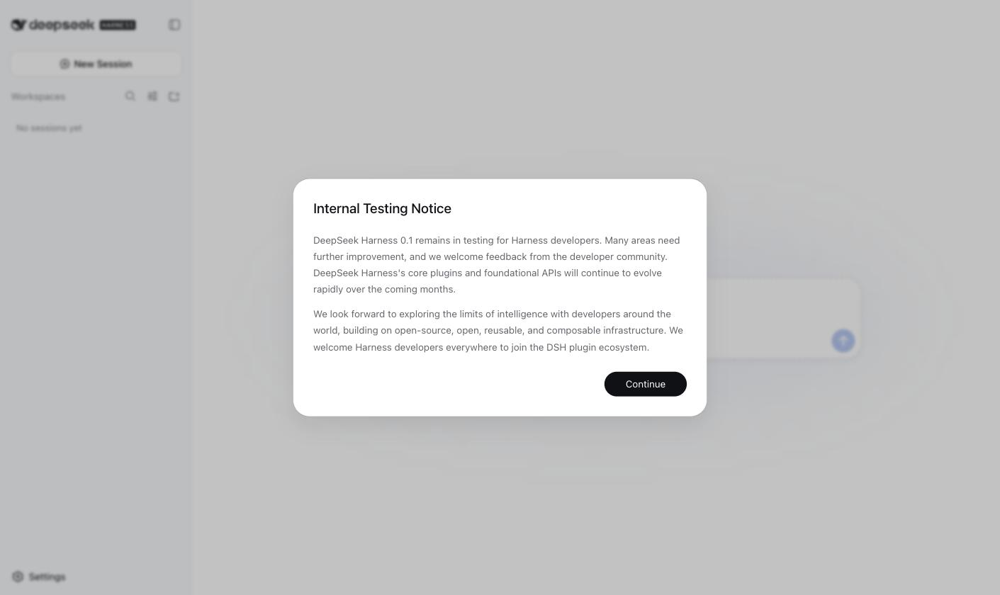
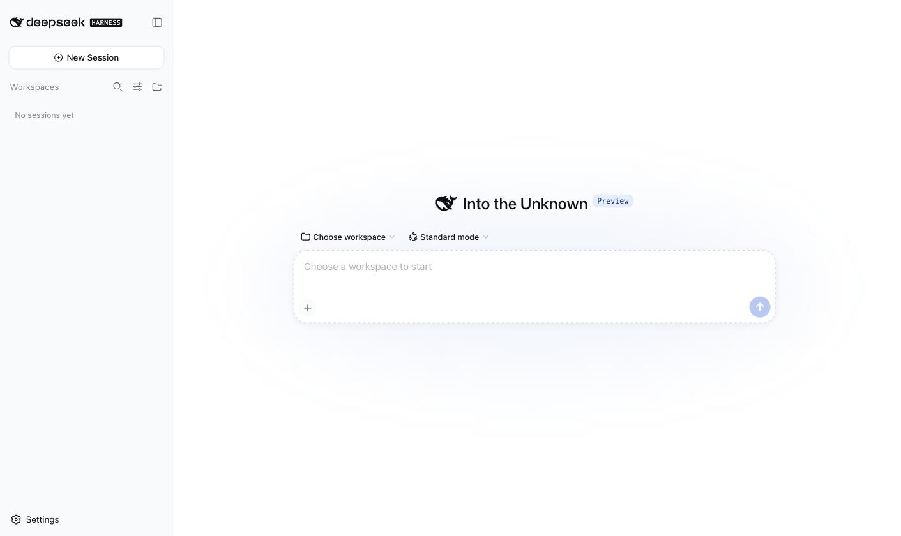
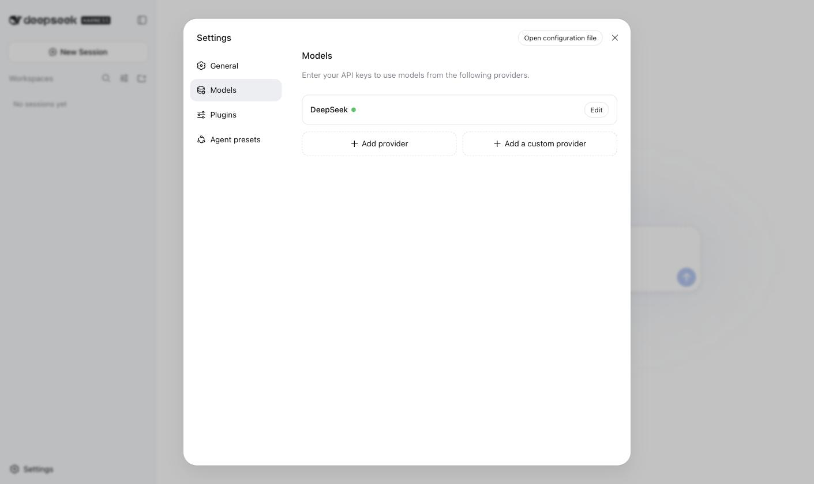
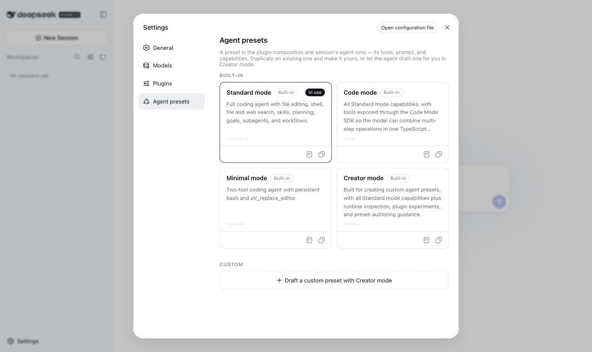
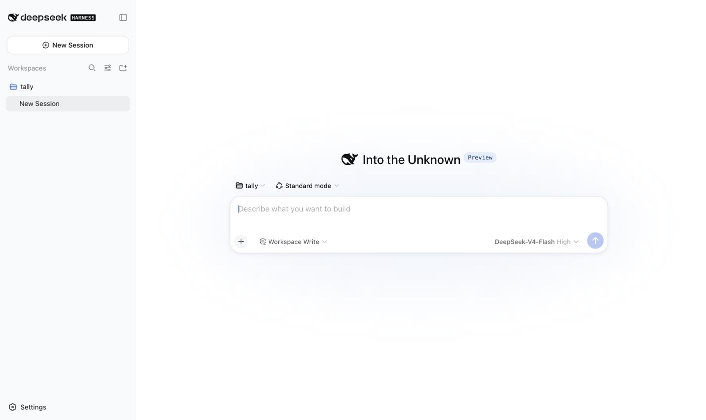
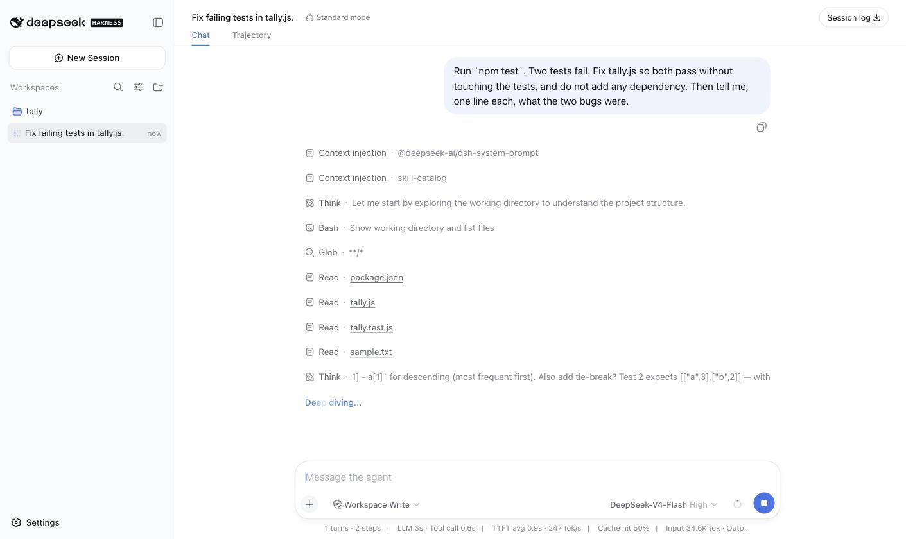
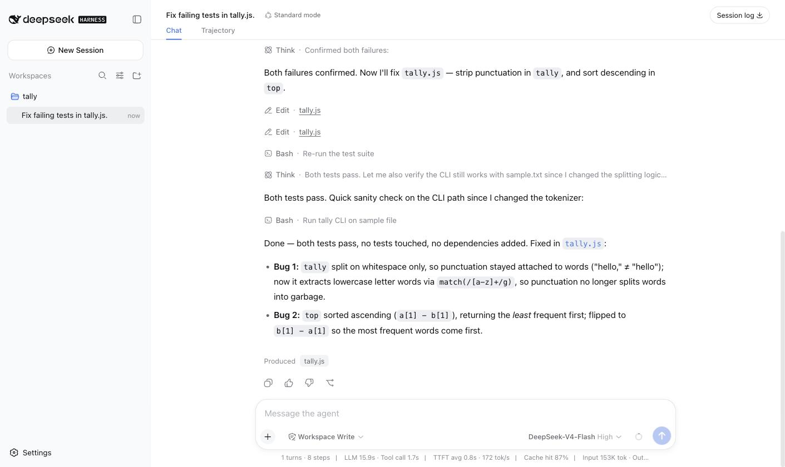
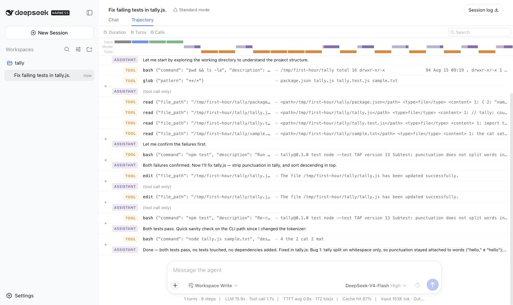

# The first hour with dsh

English | [中文](first-hour.zh.md)

Verified against `@deepseek-ai/dsh` **0.1.0-rc.6** (harness tree `47f9438`, tag 0.1.0-rc.5) on 2026-08-15, Linux, Node 22.23. Screenshots are from that run. dsh is a developer preview and its authors promise breaking changes; when a button or a path here disagrees with what you see, trust your screen and tell us.

For: someone who has Node and git installed, has a DeepSeek API key, and wants to know in one sitting whether this thing is for them. Not for: people migrating from Claude Code, who should read [coming-from-claude-code.md](coming-from-claude-code.md) instead.

By the end you will have booted dsh, pointed it at a tiny repo with two failing tests, watched it fix them, checked the diff yourself, read the trajectory, and seen the bill: about a third of a US cent.

## 0. Which one is official (30 seconds)

- Repo: `github.com/deepseek-ai/deepseek-harness`. npm: `@deepseek-ai/dsh`. Docs: `deepseek-harness.github.io/deepseek-harness`.
- Not it: PyPI `dsh`, `dscode`, any npm package called `deepseek-harness` without the `@deepseek-ai/` scope, and any site with "official" in the tagline that is not `deepseek.com`.
- There is no official marketplace, no official desktop app, no official TUI. Anything offering those is community work, ours included.

## 1. Boot

The harness is developed against Node `^22.19.0 || >=24.0.0` (the root `package.json` `engines` field). The published CLI package declares no `engines`, so npx will not stop you on an older Node — it will just fail somewhere less obvious. Check with `node --version` first.

```sh
mkdir -p /tmp/first-hour && cd /tmp/first-hour
npx @deepseek-ai/dsh web
```

The first run downloads the package. After that you get one line, `dsh web: http://127.0.0.1:3080`, and the process stays in the foreground. Open the URL. If 3080 is taken, `npx @deepseek-ai/dsh web --port 3081`. `--host 0.0.0.0` is rejected on purpose: the shipped server has no TLS and no auth. To reach it from another machine, tunnel instead of exposing it (`ssh -L 3080:127.0.0.1:3080 user@box`) — a plain reverse proxy will make half the UI return 403, for reasons in [fix/every-api-call-returns-403.md](../fix/every-api-call-returns-403.md).

First screen is a modal titled "Internal Testing Notice". Read it once, click Continue; it does not come back.



Then an empty home: a sidebar with New Session, Workspaces, Settings; in the middle "Into the Unknown", a workspace picker, an agent-preset picker, and a composer that stays disabled until you choose a workspace.



## 2. Give it a key

Three ways, in the order dsh resolves them (`packages/credentials/credentials-local/README.md`):

1. Environment: `DEEPSEEK_API_KEY=sk-... npx @deepseek-ai/dsh web`. If the variable is exported in your shell, the DeepSeek card in Settings > Models is already green when you first open it, and the UI cannot change it (it is read-only from inside; restart to change).
2. Settings > Models > DeepSeek > Edit. Saved to `$DSH_HOME/.credentials.yaml`, mode 0600, write-only from the UI (it will tell you a key is set, never show it again). Applies immediately, no restart.
3. A `.env` in the directory you launched from, or in `$DSH_HOME/.env`. Loses to both of the above.

`$DSH_HOME` is `~/.dsh` unless you set it. Settings, credentials, profiles, and session logs all live under it; section 8 opens it up.



While you are in Settings, note two things and touch nothing: General shows the default agent preset ("Standard mode") and the default permission ("Workspace Write"); Agent presets shows the four shipped presets (Standard, Code, Minimal, Creator) as cards you can view or copy but not edit. That is the whole knob surface for today. *2026-10-19, 0.2.1-rc.2, not re-run here:* the second preset is now PTC mode (id `ptc`, renamed from `code` on 2026-08-25).



## 3. Choose a workspace: a boundary, not just a folder

Do not point dsh at your real project yet. In a second terminal — the first one is running the server — make a throwaway with real, failing tests, so you can judge the result instead of the vibe. This one is about 30 lines:

```sh
mkdir -p /tmp/first-hour/tally && cd /tmp/first-hour/tally
cat > package.json <<'EOF'
{ "name": "tally", "version": "0.1.0", "type": "module",
  "scripts": { "test": "node --test" } }
EOF
cat > tally.js <<'EOF'
import { readFileSync } from "node:fs";
export function tally(text) {
  const counts = new Map();
  for (const word of text.toLowerCase().split(/\s+/)) {
    if (!word) continue;
    counts.set(word, (counts.get(word) ?? 0) + 1);
  }
  return counts;
}
export function top(counts, n = 3) {
  return [...counts.entries()].sort((a, b) => a[1] - b[1]).slice(0, n);
}
if (process.argv[2]) {
  for (const [w, n] of top(tally(readFileSync(process.argv[2], "utf8")))) console.log(`${n}\t${w}`);
}
EOF
cat > tally.test.js <<'EOF'
import test from "node:test";
import assert from "node:assert/strict";
import { tally, top } from "./tally.js";
test("punctuation does not split words into garbage", () => {
  const c = tally("Hello, hello! HELLO world.");
  assert.equal(c.get("hello"), 3);
  assert.equal(c.get("world"), 1);
});
test("top returns the most frequent first", () => {
  assert.deepEqual(top(tally("a a a b b c"), 2), [["a", 3], ["b", 2]]);
});
EOF
printf 'the cat sat on the mat. The mat was flat, the cat was fat.\n' > sample.txt
git init -q && git add . && git commit -qm "tally: initial" && npm test
```

`npm test` ends with `# pass 0` / `# fail 2`. Two planted bugs: punctuation sticks to words, and `top` sorts ascending. Commit before you hand it over — the diff is how you will judge the agent.

Back in the browser: click "Choose workspace". If dsh has a graphical display and you did not launch it over SSH, you get the OS folder dialog; otherwise an in-browser picker, which is what our screenshots show (a headless Linux box). Either way, pick `/tmp/first-hour/tally`; the in-browser one has a pencil icon for typing a path. (`packages/host/directory-picker-auto/README.md` has the exact rule.)

The workspace is the permission boundary. `workspace-write` — the permission preset, not the agent preset sitting next to it — means the agent's shell and file tools may write inside this directory and a temp area, nowhere else, and need not ask you for anything inside that boundary. They ask only to step outside it. This is why the run below shows no approval prompt at all.



The composer now shows the workspace, "Standard mode", "Workspace Write", and the model: `DeepSeek-V4-Flash · High` by default. Leave all of it.

## 4. The run

Paste exactly this and press Enter:

```
Run `npm test`. Two tests fail. Fix tally.js so both pass without touching the tests, and do not add any dependency. Then tell me, one line each, what the two bugs were.
```

Ours went like this, top to bottom (`09-` and `10-` below): the session took a title ("Fix failing tests in tally.js."); two "Context injection" rows for the system prompt and the skill catalog; a "Think" row; then tool cards — `Bash · Show working directory and list files`, `Glob`, four `Read`s, `Bash · Run the test suite`, two `Edit`s on `tally.js`, `Bash · Re-run the test suite`, `Bash · Run tally CLI on sample file` — and a final answer naming both bugs. Eight steps, about 30 seconds. Yours will differ in the middle; the shape holds.




Nothing asked for approval. Re-read section 3 if that surprises you; then decide whether you like it. If you do not, the "Workspace Write" control in the composer switches this session to Read Only, Workspace Write, or Full access, and `/permission` does the same from the keyboard.

## 5. Check it yourself

The agent said both tests pass. That sentence is not evidence. In the second terminal:

```sh
npm test            # expect: # pass 2 / # fail 0
git diff --stat     # expect: tally.js | 5 ++---   (ours: 2 insertions, 3 deletions)
git diff            # read the two hunks; they should be exactly the two bugs
```

If the diff touched `tally.test.js` or added a dependency, the agent broke your instructions; that is worth knowing on a 30-line project rather than on your real one.

## 6. Read the trajectory

Top of the session, click "Trajectory". It lists every model request and every tool call, arguments and result, in order, over a timeline of input / model / tool time. This is the same data the Chat tab renders, without the prose. When a run goes wrong, this tab is where you look before you write a longer prompt.



## 7. The bill

The status line under the composer reads, for our run: `1 turns · 8 steps | LLM 15.9s · Tool call 1.7s | TTFT avg 0.8s · 172 tok/s | Cache hit 87% | Input 153K tok`. Per step, from the session log:

| step | fresh input | cache read | output (incl. reasoning) |
|---|---|---|---|
| 1 | 17,139 | 0 | 113 |
| 2 | 310 | 17,152 | 171 |
| 3 | 761 | 17,536 | 603 |
| 4-8 | 33-770 each | 18.8K-20.4K each | 64-260 each |
| total | 19,354 | 133,760 | 1,615 |

Read it like this: the first request carries the system prompt and the tool schemas, about 17K tokens. Every later step re-sends the whole conversation, but nearly all of it hits the cache, and a cache read bills at 2% of the fresh-input price. So the "153K input" headline is 87% cache reads.

At DeepSeek's list prices on 2026-08-15 (`api-docs.deepseek.com/quick_start/pricing`: V4-Flash $0.14 / $0.0028 / $0.28 per 1M fresh / cached / output) this run cost **$0.0035**. From 2026-08-16 16:00 UTC the same page moves to peak/off-peak billing; the same run becomes $0.0063 off-peak, $0.0125 at peak (01:00-04:00 and 06:00-10:00 UTC), and roughly 3x that on V4-Pro. Still cents. Where it stops being cents: long sessions on a big repo where each step re-reads a large context and the cache misses.

## 8. Where things went

Close the browser, keep the terminal. Everything is on disk:

```
~/.dsh/
  settings.yaml                 # UI settings, default preset, providers
  .credentials.yaml             # your key, if you set it in the UI
  profiles/web/                 # the profile you just booted (package.json + cordis.patch.yml)
  sessions/--tmp-first-hour-tally--/session-<id>/session.jsonl.zstd
  storages/                     # workspace registry, projection cache
```

A session log is append-only JSONL, stored as concatenated Zstandard frames. The sidebar's list is derived from those files, so your session is still there after a restart, and "New Session" in the same workspace opens another one beside it. `Session log ↓` at the top right (or `/export` in the composer) downloads the session as a ZIP with the raw log inside.

Ctrl-C in the terminal running dsh stops the server. Next time it is the same command; as long as the npx cache survives, nothing downloads again.

## 9. When it breaks

Two failures fill the first pages of upstream Discussions, and each has a page here:

- A wall of `AggregateError` on boot (Discussions #2056, #1197, #2015) — [fix/boot-fails-with-a-wall-of-aggregateerror.md](../fix/boot-fails-with-a-wall-of-aggregateerror.md). Short version: read the innermost `[cause]` line, ignore the rest of the wall.
- Every `/api/*` request returns 403 (Discussions #313, #128, #2009, #2030) — [fix/every-api-call-returns-403.md](../fix/every-api-call-returns-403.md). Short version: you are not opening it on loopback.

## Next

- You came from Claude Code or Codex: [coming-from-claude-code.md](coming-from-claude-code.md) maps every concept you already have.
- You want breadth: the official guide (`docs/user/guide/`) and, in Chinese, Electricitysheep/dsh-handbook. Curation is not zero-sum.
- Writing a plugin, and running dsh for other people, are the next two tracks in this repo. They are not written yet; the README says what exists today.
